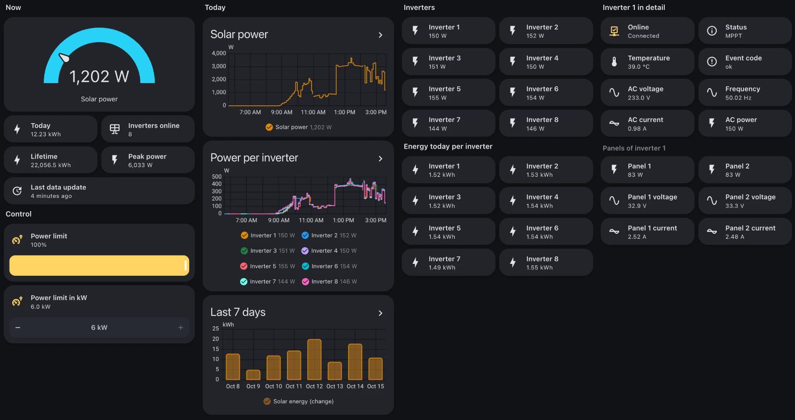
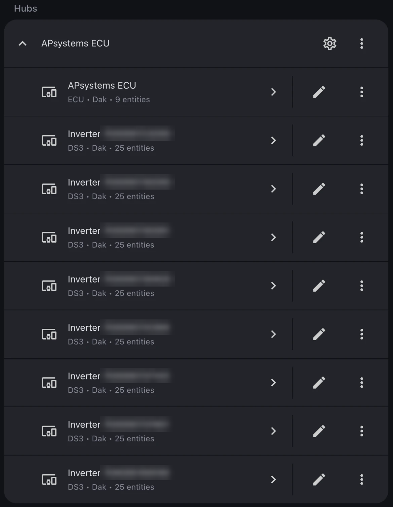
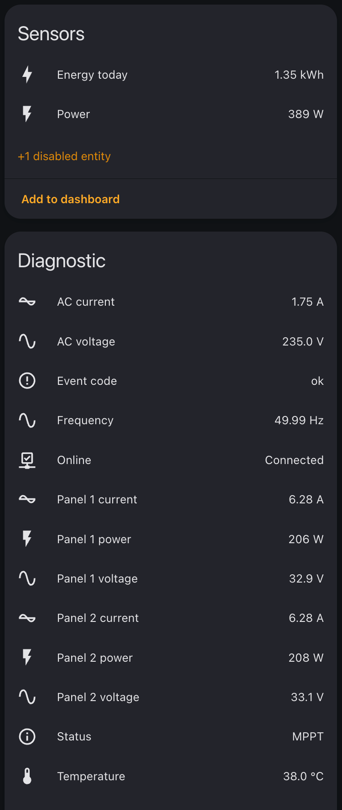
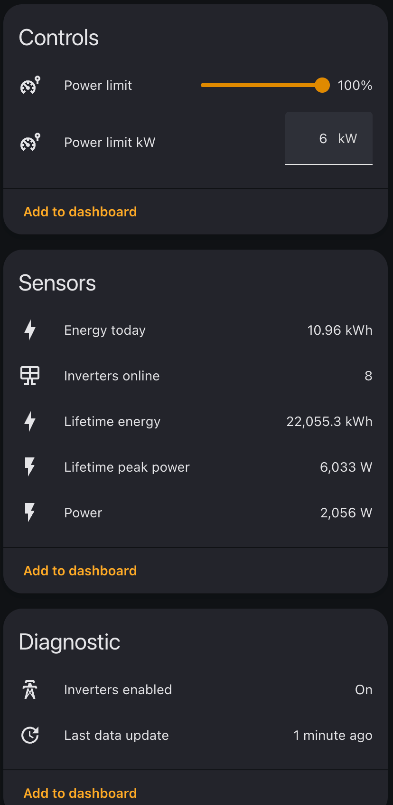

# APsystems Modbus for Home Assistant

[](https://github.com/christianvaes/homeassistant-apsystems_modbus/releases)
[](https://hacs.xyz)
[](https://github.com/christianvaes/homeassistant-apsystems_modbus/actions/workflows/ci.yml)
[](https://www.home-assistant.io)
[](https://github.com/christianvaes/homeassistant-apsystems_modbus/commits/main)
[](https://www.paypal.com/donate/?business=FAQ9J5JDQY7NW&no_recurring=1&currency_code=EUR)

Fully local Home Assistant integration for solar panels with APsystems
microinverters and an ECU, over Modbus TCP.



Features:

- **One device for the whole system (the ECU)** with current solar power,
  energy today, lifetime energy for the Energy dashboard, highest power ever
  measured and inverters online.
- **One device per microinverter** with its own power, energy today, voltage,
  current, frequency, temperature, power per panel, status and event code.
- **Control: power limit.** Curtail the output of all inverters, in percent
  or in kW, by hand or from an automation. With a dynamic tariff you can go
  to zero export at negative prices and back to full power when they recover.
- **Setup**: the ECU is discovered on your network and the inverters are found
  automatically.

Unofficial, not affiliated with APsystems. Use at your own risk. The power
limit changes what your inverters do, so read that section first.

## Supported hardware

| ECU | Serial starts with | Modbus from firmware | Status |
|---|---|---|---|
| ECU-R | 2160 | 1.3.7 | Tested (1.3.23, DS3 inverters) |
| ECU-R Pro | 2162 | 2.0.2 | Expected to work, not tested |
| ECU-C | 215 | C1.1.3 | Expected to work, not tested |
| ECU-B | 2163 | not supported by APsystems | Not supported |

Supported ECUs have a SunSpec logo on the device. Other inverter models should
work but only DS3 is tested. For the EZ1, use the core `apsystems` integration.
Have an untested ECU or inverter? Open an issue with a register dump (see
Troubleshooting).

## Before you start

1. Connect the ECU with an **Ethernet cable** and give it a fixed IP address.
   Modbus only works on the wired port.
2. **Enable Modbus on the ECU.** It is off by default. The setting is in the
   *EMA Manager* app, which normally needs an installer account. Without one,
   use the ECU's local access point:
   - Install EMA Manager on your phone.
   - Press the **AP button** on the side of the ECU and connect your phone to
     the Wi-Fi network it starts (`ECU_R_2160…`, default password `88888888`).
   - Open EMA Manager and choose **Local Access**.
   - Go to *Workspace → Modbus settings* (in some app versions *Modbus
     Configuration*), switch Modbus on, give every inverter an address (1, 2,
     3, …) and save.
3. With Modbus on, APsystems features such as Dynamic Tariff stop working.
4. Let **nothing else talk to the ECU over Modbus**. In tests a second
   connection made the ECU stop answering the integration.
5. Home Assistant 2026.10.0 or newer.

## Installation and setup

[](https://my.home-assistant.io/redirect/hacs_repository/?owner=christianvaes&repository=homeassistant-apsystems_modbus&category=integration)

Open the repository in HACS with the button, choose *Download* and restart
Home Assistant. Or in HACS, open the menu → *Custom repositories*, enter
`https://github.com/christianvaes/homeassistant-apsystems_modbus` and choose
type *Integration*.

Home Assistant discovers the ECU on your network. Accept it under *Settings →
Devices & services*, or add it yourself:

[](https://my.home-assistant.io/redirect/config_flow_start/?domain=apsystems_modbus)

The dialog explains every field. Leave the inverter addresses empty to find
the inverters automatically.

You get one device for the ECU and one device per inverter.

<table>
  <tr>
    <th>Devices</th>
    <th>One inverter</th>
  </tr>
  <tr>
    <td valign="top"></td>
    <td valign="top"></td>
  </tr>
</table>

Under *Configure* you can enter the installation power, correct the lifetime
energy and reset the peak power. A correction shows up once as production in
that hour. Fix that under *Settings → Tools → Statistics*.

## Energy dashboard

Add **Lifetime energy** of the ECU device as solar production under
*Settings → Dashboards → Energy*.

## Power limit

**Power limit** on the ECU device curtails the output of all inverters, in
whole percent. 100 is no limit. Set it by hand or with `number.set_value`.

- Inverters follow a change within a few minutes, in tests up to about 15.
- At 0 each inverter still delivers about 20 to 30 W.
- The integration keeps the limit in place by itself. After a failed change,
  a restart of Home Assistant, or when the connection to the ECU broke, as
  with most restarts of the ECU, it sends the limit again.
- With the installation power entered, a second control sets the same limit
  in kW. If an inverter then delivers clearly more than the limit allows, a
  notice under *Settings → Repairs* asks you to check the installation power.
- If an inverter stays limited, set the limit to 100. If that does not help,
  switch the ECU off for a minute.



Example: no export at negative feed-in prices. Replace the entity IDs with
yours.

```yaml
automation:
  - alias: Solar panels and negative price
    triggers:
      - trigger: numeric_state
        entity_id: sensor.feed_in_price
        below: 0
        id: "off"
      - trigger: numeric_state
        entity_id: sensor.feed_in_price
        above: 0
        id: "on"
    actions:
      - action: number.set_value
        target:
          entity_id: number.apsystems_ecu_power_limit
        data:
          value: "{{ 0 if trigger.id == 'off' else 100 }}"
```

## Good to know

- The ECU fetches new data from the inverters over Zigbee every 5 minutes.
  The integration reads it right after that, so values in Home Assistant are
  at most about a minute and a half old. Daily totals can differ about 1 %
  from the EMA app.
- At night inverters read 0 V and 0 Hz. Energy today follows the ECU, which
  resets it during the night.
- When the ECU answers slowly, the integration waits longer and reads fewer
  registers, so most inverters still come through. Setting the power limit
  can then take a minute or more.
- The ECU serves one Modbus connection at a time. Another Modbus tool on the
  ECU at the same time can make the integration lose its connection, so
  stop such tools while it runs.
- An inverter that a poll misses keeps its last values for 15 minutes, also
  in the totals. After that it becomes unavailable, but Energy today keeps
  its share. If the ECU stops answering, the integration tries again after
  every round of the ECU and recovers by itself.
- A replaced inverter on the same address keeps counting under its existing
  device. If you give an inverter another address in EMA Manager, a repair
  asks you to choose Reconfigure. Devices and history are kept.

## Troubleshooting

| Message | What to do |
|---|---|
| The ECU refused the connection | Modbus is off: enable it in EMA Manager and assign addresses |
| No answer from the ECU | Check the IP address and the Ethernet cable |
| No inverter answered | Assign addresses in EMA Manager or enter them manually |
| The ECU stopped answering | Stop other Modbus clients, wait five minutes, try again |
| Register layout differs | Share a register dump in an issue |
| Inverter has a new address | Choose Reconfigure in the menu of the integration |

**Reporting an issue:** add the diagnostics from the menu of the integration.
They contain no addresses or serial numbers. Turn on debug logging in the same
menu if you can reproduce the problem.

For an untested ECU, also add a register dump. Disable the integration first,
because a second Modbus connection disturbs the ECU. Then run on a computer in
your network:

```bash
python3 tools/dump_registers.py --host <ecu-ip> --units 1 2 --probe-unit 9 --out .
```

It only reads. Replace the serial numbers in the JSON file before sharing, and
enable the integration again.

## Removing the integration

Set the power limit to 100 and check that all inverters deliver power again.
Then delete the integration under *Settings → Devices & services*.
The lifetime total is kept, so it continues when you add the same ECU again.

## Support the project

If this integration is useful to you:

- **Star this repository** on GitHub
- [Buy me a coffee](https://www.paypal.com/donate/?business=FAQ9J5JDQY7NW&no_recurring=1&currency_code=EUR)

## License

Apache-2.0. Unofficial and not affiliated with APsystems.
